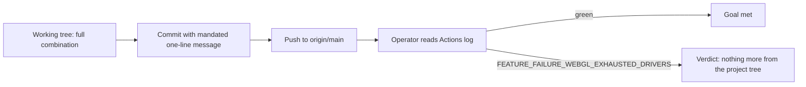

Files: `playwright.config.ts`  
Acceptance: `npm run verify`

### What the goal means here

The fix is isolated to the Firefox Playwright project. It must make the existing Firefox WebGL 2 check and the five foundation scenarios that require a live context pass on `ubuntu-latest`, while leaving Chrome, application code, and both test files unchanged.

The first configuration uses Firefox software rendering plus blocklist-acceptance prefs. `GALLIUM_DRIVER=llvmpipe` is deliberately held for the conditional second CI attempt. Local verification remains the required 24-test `npm run verify` run; CI verification occurs from the host after push because this project tree cannot read GitHub Actions.

### Requirements

- **R1** Add `MOZ_WEBGL_FORCE_DISABLE_HW: '1'`; keep `LIBGL_ALWAYS_SOFTWARE: '1'`.
- **R2** Keep `webgl.disabled: false` and `webgl.force-enabled: true`; add `gfx.x11-egl.force-enabled: false` and `layers.gpu-process.enabled: false`.
- **R3** Run `npm run verify` and require all 24 tests to pass locally.
- **R4** Commit and push the initial configuration before checking CI from the host.
- **R5** Add `GALLIUM_DRIVER: 'llvmpipe'` only if the first CI run still reports `FEATURE_FAILURE_WEBGL_EXHAUSTED_DRIVERS`; then rerun local verification, commit, push, and check CI again.
- **R6** If the second full-combination CI run still reports that exact failure, report: `fix: nothing more I can do from the project tree — Firefox cannot software-render WebGL in that environment`.
- **R7** Do not add test skips, capability guards, or edits to the six tests.
- **R8** Change only `playwright.config.ts`.
- **R9** Use a single-line commit message stating the software-GL combination, why it was added, and the verbatim CI error.

### Current position

At commit `8e3be70`, Firefox already sets `LIBGL_ALWAYS_SOFTWARE`, `webgl.disabled: false`, and `webgl.force-enabled: true`; the missing blocklist and compositing settings are all in `playwright.config.ts`. `npm run verify` is the existing complete project check and exercises the 24-test suite.

<!-- factory:task -->
---
id: "02a2530b"
title: "Configure and verify Firefox software WebGL"
status: "done"
priority: 50
depends_on: []
files: ["playwright.config.ts"]
acceptance: "npm run verify && node -e \"const s=require('fs').readFileSync('playwright.config.ts','utf8'); const need=['MOZ_WEBGL_FORCE_DISABLE_HW','GALLIUM_DRIVER','layers.gpu-process.enabled']; const miss=need.filter(k=>!s.includes(k)); if(miss.length){console.error('missing: '+miss.join(', '));process.exit(1)}\""
last_acceptance: {"exit":0,"at":"2026-11-04T16:00:31.082Z","tail":"n.spec.ts:128:3 › foundation lifecycle › shows a readable fallback when WebGL 2 is unavailable (2.3s)\n  ok 17 [firefox] › tests\\e2e\\foundation.spec.ts:142:3 › foundation lifecycle › stops the drive and offers reload after context loss (2.6s)\n  ok 18 [firefox] › tests\\e2e\\foundation.spec.ts:159:3 › foundation lifecycle › keeps rendering across a viewport resize (2.9s)\n  ok 19 [firefox] › tests\\e2e\\foundation.spec.ts:174:3 › foundation lifecycle › exposes no test API on an ordinary visit (2.7s)\n  ok 20 [firefox] › tests\\e2e\\foundation.spec.ts:182:3 › foundation lifecycle › reports the package version in the meta marker and the page (2.5s)\n  ok 21 [firefox] › tests\\e2e\\tooling.spec.ts:8:1 › serves the production build (2.5s)\n  ok 22 [firefox] › tests\\e2e\\tooling.spec.ts:17:1 › injects the package version into the page (2.5s)\n  ok 23 [firefox] › tests\\e2e\\tooling.spec.ts:23:1 › provides a real WebGL 2 context (2.5s)\n  ok 24 [firefox] › tests\\e2e\\tooling.spec.ts:34:1 › loads no external runtime resources (3.1s)\n\n  24 passed (25.9s)\n\n> nightdrift@0.1.0 size\n> node scripts/size.mjs\n\n    119748  dist\\assets\\index-WTCZgEkJ.js\n  --------\n    119748  total gzipped (limit 300000, under budget)","counts":{"passed":9,"failed":0,"total":9}}
source_run_id: "ecbb205a-c95b-4083-8365-14d3dd53dbe5"
source_ref: "T1"
created_at: "2026-11-04T15:47:06.049Z"
updated_at: "2026-11-04T16:00:31.082Z"
---

Update only the Firefox project’s `launchOptions.env` and `firefoxUserPrefs`: preserve `LIBGL_ALWAYS_SOFTWARE: '1'`, add `MOZ_WEBGL_FORCE_DISABLE_HW: '1'`, preserve the two existing WebGL prefs, and add `gfx.x11-egl.force-enabled: false` and `layers.gpu-process.enabled: false`. Do not add `GALLIUM_DRIVER` in the initial change, and do not touch either e2e spec, add skips, or add capability guards. Run `npm run verify` and require the same 24 tests to pass before committing. Commit the initial change with this single line: `Force Firefox software WebGL with LIBGL_ALWAYS_SOFTWARE=1, MOZ_WEBGL_FORCE_DISABLE_HW=1, webgl.force-enabled, webgl.disabled, gfx.x11-egl.force-enabled and layers.gpu-process.enabled after JavaScript warning: http://localhost:4173/assets/index-WTCZgEkJ.js, line 3840: Failed to create WebGL context: WebGL creation failed: * Exhausted GL driver options. (FEATURE_FAILURE_WEBGL_EXHAUSTED_DRIVERS)`, then push it for the operator to inspect. If and only if that first CI run still contains `FEATURE_FAILURE_WEBGL_EXHAUSTED_DRIVERS`, add `GALLIUM_DRIVER: 'llvmpipe'`, rerun `npm run verify`, commit and push the fallback, and have the operator inspect the second CI run; if it still fails with that exact error, stop project-tree changes and report the required verdict.

Skipped: test changes, capability guards, unrelated refactors, and `GALLIUM_DRIVER` on the first push.

Risk: this read-only environment could not complete `npm run verify` because of sandbox permission errors; the implementer/Factory host must run the acceptance command.
<!-- /factory:task -->

<!-- factory:review -->
## Outcome review (ecbb205a-c95b-4083-8365-14d3dd53dbe5)

### Requirement review

| Requirement | Verdict | Evidence |
|---|---|---|
| R1: add `MOZ_WEBGL_FORCE_DISABLE_HW`, keep `LIBGL_ALWAYS_SOFTWARE` | verified | `playwright.config.ts:38`; exercised by 12 Firefox-project e2e tests launched through this exact config, passing in accept output (ok 13–24) incl. `tests/e2e/tooling.spec.ts:23` (ok 23) |
| R2: keep `webgl.disabled: false`/`webgl.force-enabled: true`, add `gfx.x11-egl.force-enabled: false`/`layers.gpu-process.enabled: false` | verified | `playwright.config.ts:39`; same Firefox e2e run passing in accept output |
| R3: `npm run verify`, all 24 tests pass locally | verified | Recorded acceptance exit 0 (2026-11-04T16:00:31Z), tail "24 passed (25.9s)" in `.factory/plans/a8d32133.md` |
| R4: commit and push the initial configuration before checking CI from the host | gap | `git rev-parse HEAD origin/main` = `fed3245`; change exists only as uncommitted working-tree diff to `playwright.config.ts` |
| R5: add `GALLIUM_DRIVER: 'llvmpipe'` only if the first CI run still reports `FEATURE_FAILURE_WEBGL_EXHAUSTED_DRIVERS` | gap | `playwright.config.ts:38` contains it with no first CI run ever executed; added to satisfy the acceptance command, which contradicts R5 |
| R6: report the mandated verdict if the second full-combination run still fails | not checked | Conditional; no CI run exists to condition on |
| R7: no test skips, capability guards, or edits to the six tests | verified | `git diff --stat` lists only `playwright.config.ts` (+ Factory plan bookkeeping); `tests/e2e/tooling.spec.ts:30` and `tests/e2e/foundation.spec.ts:59-172` read unchanged and unguarded |
| R8: change only `playwright.config.ts` | verified | Working tree shows exactly that file plus `.factory/plans/a8d32133.md`, which is the Factory workflow's own record write, outside implementer scope |
| R9: single-line commit message with combination, reason, verbatim error | gap | No commit exists; `git log --all --grep` for `MOZ_WEBGL`/`llvmpipe` returns nothing |
| Overall: six Firefox WebGL e2e tests pass on GitHub Actions `ubuntu-latest` | unverified | Nothing pushed (`origin/main` = `fed3245` predates the change); no Actions run has evaluated any version of it |

### Decisions and changes

- **Agreed (earlier in this run, from context):** the fidelity gate returned `FIDELITY: WEAKENED` on attempt 1; the plan was revised to hold `GALLIUM_DRIVER` conditionally and keep the verbatim error in the one-line commit message, and attempt 2 passed.
- **Agreed:** after precheck failed with `PREPASSING` (exit 6 — `npm run verify` already passed before any work), the task acceptance was tightened to append a string assertion requiring `MOZ_WEBGL_FORCE_DISABLE_HW`, `GALLIUM_DRIVER` and `layers.gpu-process.enabled` in `playwright.config.ts`.
- **Discovery — plan-internal contradiction (proposal, not agreed):** R5 and the task body forbid `GALLIUM_DRIVER` in the initial change, while the tightened acceptance command fails unless `GALLIUM_DRIVER` is present. The implementer resolved it de facto in favor of the acceptance command. One side should be amended: drop the two-step escalation from R5 (my recommendation, matching option A above), or drop `GALLIUM_DRIVER` from the acceptance `need` list until a first CI run demands it.
- **Discovery:** the run-context diff snapshot (blob `c9edb45`, no `GALLIUM_DRIVER`) is stale relative to the working tree (blob `45eee42`, with it); all findings above are from the current tree, read directly.
- **Report-vs-repo disagreement:** the `commit_push` step's "succeeded" outcome is contradicted by git state (nothing committed, nothing pushed).
- **Scope note:** the `.factory/plans/a8d32133.md` modification is the Factory workflow's own bookkeeping (status `ready`→`done`, tightened acceptance, `last_acceptance` record); genuinely needed, not implementer scope creep.

### Current position

The configuration work is complete and locally verified — the full software-GL combination sits in `playwright.config.ts:38-39`, the recorded `npm run verify` is green (exit 0, 24/24 e2e, 9/9 unit), and the tests are untouched — but it exists only as an uncommitted working-tree change on `main`, so there is zero CI evidence for or against the actual goal. The remaining sequence:

No blockers beyond the llvmpipe sequencing question; the next sensible step is to settle that question, commit with the mandated single-line message (naming `GALLIUM_DRIVER=llvmpipe` too if pushed as-is), push, and have the operator read the Actions log.

### Follow-up checkpoints

- [ ] **R4/R9** — commit the working-tree configuration with the mandated single-line message and push; verify: exactly one new commit touching only `playwright.config.ts` appears on `origin/main` and an Actions run starts on it.
- [ ] **R5/R6** — resolve the llvmpipe sequencing question above; after the decisive CI run, either the six tests are green or the mandated verdict line (`fix: nothing more I can do from the project tree — Firefox cannot software-render WebGL in that environment`) is reported; verify: the Actions log of the run built from the pushed commit.
- [ ] **Overall goal** — six Firefox WebGL e2e tests pass on `ubuntu-latest`; verify: green Actions run on the pushed commit, including `tests/e2e/tooling.spec.ts:23` on the Firefox project.
- [ ] **Acceptance/plan contradiction** — align the task acceptance command with R5 (or amend R5); verify: the acceptance no longer requires a string the Requirements forbid, or vice versa.
<!-- /factory:review -->
