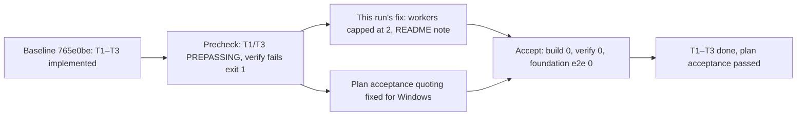

All evidence is gathered — the source tree contains exactly the Foundation modules, later-phase files don't exist yet, and every claim in the accept output traces to real code and real tests. Here is the review.

## Goal

Implement **Nightdrift v0.1.0 "First drive"** through Factory: a browser toy that renders an endless, seeded, procedurally generated night city with a generative ambient score, per the plan's ten requirements R1–R10 with overall acceptance `npm run verify`. The original-request field is an unresolved template placeholder (`{{input.goal}}`), so the plan's title and Requirements section are the goal. The selected batch is the plan's **Foundation phase: T1 (bootstrap/build), T2 (quality scripts and CI), T3 (empty scene, Start lifecycle, Factory capture)** — a partial phase, not the whole release.

## Result

The Foundation phase is verified: all three tasks' acceptance commands exited 0 in this run's accept (`npm run build`; `npm run verify` with 9 unit + 24 e2e tests passing and the bundle at 119,748 of 300,000 bytes; foundation e2e 16/16 in both browser projects), and each claim traces to real implementation code and real browser tests in the repository — with the caveat that T1 and T3 were already passing before this run's work, and this run's own diff (the Playwright worker cap) is proven only by T2's red→green `verify`. Coverage report summary line, exactly: "no acceptance segment could be measured: nothing above says whether the change was executed".

## What worked

This run turned out to be a **repair/finalization round**, not a green-field build. The precheck shows `3e5ce721` and `50f600f3` PREPASSING — the Foundation implementation was already committed at baseline `765e0be` — and `1dca243d`'s `npm run verify` failing (exit 1) due to e2e flakiness. This run diagnosed and fixed the flakiness, then finalized all three tasks. Verification below covers the delivered state, which is what the acceptance commands exercise.

| Acceptance | Exit | Evidence |
|---|---|---|
| `npm run build` (3e5ce721) | 0 | 11 modules, 472.62 kB / 119.75 kB gzip |
| `npm run verify` (1dca243d) | 1 → 0 after fix | 9 unit + 24 e2e passed, size 119,748 < 300,000 |
| foundation e2e (50f600f3) | 0 | 16 passed, both projects |

**T1 — Bootstrap and production build.** Single-source version injection: `vite.config.ts:4-11` reads `package.json` and defines `VITE_APP_VERSION` plus an HTML transform; `index.html:6` carries the meta marker; `src/main.ts:4` consumes the define; `src/ui.ts:32` renders it. `package.json:3` pins `0.1.0`. Tests: `tests/e2e/tooling.spec.ts:17-21` and `tests/e2e/foundation.spec.ts:182-187` compare the served page against `package.json` in both browsers.

**T2 — Quality scripts and CI.** All seven scripts plus `dev`, verify fail-fast in the required order (`package.json:9-19`), asserted by `tests/tooling.test.ts:41-52`. Runner isolation is real: Vitest excludes `tests/e2e` (`vite.config.ts:14-18`), Playwright owns `tests/e2e` (`playwright.config.ts:7-8`). The size gate implements the proposed conservative accounting — every emitted JS file gzip-summed once, strictly below 300,000, missing or empty output fails (`scripts/size.mjs:24-37`), with tests at all three threshold boundaries (`tests/tooling.test.ts:96-104`) and missing/empty-output cases (`:64-72`). The web server builds first on a strict port and refuses a server it did not start (`playwright.config.ts:45-52`). CI installs locked deps and browsers, records versions, runs verify, uploads failure diagnostics (`.github/workflows/ci.yml:20-44`). **This run's actual change** is `playwright.config.ts:17` — workers capped at 2 locally (1 in CI) with the starvation rationale in a comment — documented in this run's README diff (`README.md:81-84`). The precheck's red run and the accept's green run bracket this change.

**T3 — Empty scene, Start lifecycle, Factory capture.** Readiness is granted only from inside the render loop, after a rendered frame, only when audio is running (`src/app.ts:27,78-83`) — matching `.factory/ui.json`'s click contract `["#start", "canvas[data-ready='true']"]` exactly. The AudioContext is constructed synchronously before the first await inside the click gesture (`src/audio.ts:44-55`, dispatched synchronously from `src/ui.ts:47-51`). Repeated Start is inert (`src/app.ts:107`, `tests/e2e/foundation.spec.ts:86-101` counts one canvas). Activation failure keeps the drive running with status and retry, readiness withheld, and stale completions discarded via generation counters (`src/app.ts:99-117`, `src/audio.ts:39-57`, `tests/e2e/foundation.spec.ts:103-126`). The fallback test disables real context acquisition before app code loads — not a test-only shortcut — and the app probes WebGL 2 before constructing a renderer (`tests/e2e/foundation.spec.ts:34-46,128-140`, `src/scene.ts:8-18,46-56`). Context loss uses the genuine `WEBGL_lose_context` extension (`tests/e2e/foundation.spec.ts:147-151`) and stops the loop, clears readiness, disposes audio and offers reload (`src/app.ts:63-71`, `src/scene.ts:56-62`). Teardown removes listeners, test API, UI, renderer and closes the audio context (`src/app.ts:119-131`, `src/main.ts:10`). The test API exposes real `renderer.info` counters and exists only under `?test=1` — `?debug=1` alone exposes nothing (`src/scene.ts:80-85`, `tests/e2e/foundation.spec.ts:174-180`). Silence before Start is asserted as `audio: 'idle'` with no constructed context (`tests/e2e/foundation.spec.ts:67`, `src/audio.ts:20-22`), and the graph stays silent by construction (`src/audio.ts:47`), consistent with decision D17.

## What did not

Nothing failed in the final accept, but three evidence caveats belong here rather than in "worked":

- **T1 and T3's passing acceptance cannot prove this run's work.** Both were PREPASSING before any work (context: "already passes before any work, so it cannot prove this change"); their code landed in a previous run at baseline `765e0be`. This run legitimately finalized them via the supervisor's prescribed path, but the run's only red→green proof is T2's `verify`.
- **The flakiness fix is supported by one red run and one green run.** The worker-starvation diagnosis is plausible and well documented (`playwright.config.ts:12-16`), but a single pass does not establish determinism; the six changed lines also have no measured coverage segment.
- **No Factory capture artifact or interaction log is in evidence.** The readiness contract is implemented and e2e-asserted, but decision D9's requirement to inspect the actual capture log before accepting the screenshot has not yet produced visible evidence.

## Questions that need your input

None for this batch — Foundation is complete and nothing in it depended on an unanswered question. **Q1** (what audible property "never repeats exactly" requires) remains open from the plan and still does not block work; it must be answered explicitly before T9/T13 acceptance evidence is recorded, per the plan's own framing.

## Requirement review

| Requirement | Verdict | Evidence |
|---|---|---|
| R1 Seeded experience | outside selected phase | Owned by T4/T11 (backlog); no seed handling exists in `src/` yet. |
| R2 Infinite city | outside selected phase | Owned by T4–T6 (backlog); no city modules exist. |
| R3 Drift camera | outside selected phase | Owned by T7/T8 (backlog). |
| R4 Atmosphere and comfort | outside selected phase | Owned by T8 (backlog). |
| R5 Generative music | outside selected phase | Owned by T9/T10 (backlog); Q1 still open. |
| R6 Audio lifecycle — *Foundation subset: start only after Start, running context after activation, failure/retry, no duplicate voices, stale-completion protection* | verified | Gating `src/app.ts:106-112`; gesture-sync construction `src/audio.ts:44-55`; retry `src/app.ts:114-117`; stale guards `src/app.ts:99-103`, `src/audio.ts:49-57`; tests `tests/e2e/foundation.spec.ts:59-84,103-126` (16/16 in accept). Volume/mute/pause/seed-reset clauses belong to T10/T12 — outside selected phase. |
| R7 Interface — *Foundation subset: start screen, labelled controls, version display, audio status/retry* | verified | `src/ui.ts:26-39` (real buttons, `role="status"`, `aria-live`), version line `src/ui.ts:32`; tests `tests/e2e/foundation.spec.ts:59-84,182-187`. HUD pause/volume/mute/new-seed/fullscreen, localStorage, About dialog and visible-focus completion belong to T11/T12 — outside selected phase. |
| R8 Failure handling — *Foundation subset: WebGL fallback, context loss recovery, audio failure feedback without uncaught errors* | verified | Fallback `src/app.ts:46-56` + `src/scene.ts:8-18`, test `foundation.spec.ts:128-140`; context loss `src/app.ts:63-71` + `src/scene.ts:56-62`, test `:142-157`; audio failure `:103-126` with `errors).toEqual([])` assertions. Storage-denial clause belongs to T11 — outside selected phase. |
| R9 Diagnostics and identity — *Foundation subset: `?test=1` real renderer stats, API absent otherwise, version meta + page from `package.json`* | verified | Real counters `src/scene.ts:80-85`; isolation `tests/e2e/foundation.spec.ts:174-180`; version `tests/e2e/foundation.spec.ts:182-187` + `vite.config.ts:4-11`, `index.html:6`. Simulated driving speed (T8) and the `?debug=1` overlay (T12) are outside selected phase. |
| R10 Delivery — *Foundation subset: production build, seven scripts, bundle under 300 KB with conservative accounting, capture readiness contract* | verified | Build green in accept; scripts `package.json:9-19` + `tests/tooling.test.ts:41-52`; gate `scripts/size.mjs:24-37` at 119,748/300,000 with boundary tests `tests/tooling.test.ts:96-104`; contract `.factory/ui.json:6` asserted at `foundation.spec.ts:59-84`. Stock-browser smoke check and the full seven-check e2e contract belong to T13; no capture log inspected yet — see follow-ups. |

## Decisions and changes

**Agreed (this run's changes):** the Playwright worker cap (2 local, 1 CI) with its starvation rationale documented in the README — necessary to make `npm run verify` deterministic, exercised by the red→green accept. The plan record's acceptance quoting was also repaired for Windows (`"npm run verify"` was being parsed as one executable name during plan-check).

**Recorded (discovery, not a decision):** the Foundation implementation predates this run and arrives via baseline commit `765e0be`; this run's contribution is the flakiness fix plus finalization of T1/T3, which the supervisor routed through the prescribed `accept --final` path after flagging them as PREPASSING. Task statuses honestly reflect that routing rather than new implementation.

**Proposals:** none new. The plan's D14 (aggregate size accounting) was already applied as proposed and is now enforced and tested; Q1 remains a proposal awaiting the operator, unchanged.

## Current position

Foundation (T1–T3) is done with real acceptance evidence, and the plan's overall acceptance (`npm run verify`) passes. Ten checkpoints remain in backlog across City, Drive & atmosphere, Sound and Interface; the repository contains only the Foundation modules, so later phases are genuinely untouched rather than half-started. No technical blockers. The next sensible step is the **City phase, starting with T4** (deterministic chunks and shared road grid), whose only dependency — T2's tooling — is complete and green.

## Follow-up checkpoints

- [ ] **R10 / D9 — inspect the actual Factory capture.** The readiness contract is e2e-asserted, but no capture log or screenshot of the started scene is in evidence. Verification idea: run the Factory screenshot runner against the dev server and review its interaction log alongside the captured image.
- [ ] **R10 — flakiness fix rests on a single observation.** If `verify` intermittently fails again despite the worker cap, revisit parallelism (per-project serial groups or separate servers). Verification idea: repeat local `npm run verify` a few times before the T13 release pass.
- [ ] **R10 — stock-browser smoke checks** (current stock Chrome and Firefox) are documented as release activities in `README.md:59-63` and remain outstanding until T13.
- [ ] **R6/R7/R9 — outstanding clauses** (volume/mute/pause, HUD/localStorage, driving-speed API, `?debug=1` overlay) ride with their owning checkpoints T8, T10–T12; listed for traceability only, not new work.
- [ ] **R5 / Q1 — the music interpretation question** must be answered explicitly before T9's construction is treated as acceptance evidence at T13.

## Proposed tasks

none
