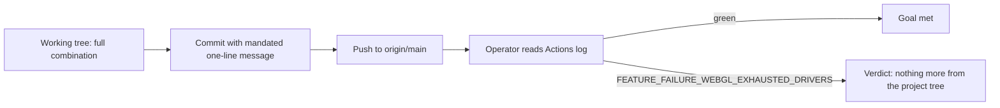

## Goal

Make the six Firefox WebGL e2e tests pass on GitHub Actions `ubuntu-latest` by fixing Firefox's GL driver blocklist exhaustion — verbatim CI error: `Failed to create WebGL context: WebGL creation failed: * Exhausted GL driver options. (FEATURE_FAILURE_WEBGL_EXHAUSTED_DRIVERS)` — through the Firefox Playwright project in `playwright.config.ts` only: add `MOZ_WEBGL_FORCE_DISABLE_HW: '1'` alongside the existing `LIBGL_ALWAYS_SOFTWARE: '1'`, extend `firefoxUserPrefs` with `gfx.x11-egl.force-enabled: false` and `layers.gpu-process.enabled: false` while keeping the two WebGL prefs, hold `GALLIUM_DRIVER: 'llvmpipe'` for a conditional second CI attempt, keep `npm run verify`'s 24 tests green on this Windows machine, commit and push the initial configuration with a single-line message citing the verbatim error, and add no test skips, capability guards, or edits to the six tests.

## Result

R1, R2, R3, R7 and R8 are verified — `playwright.config.ts:38-39` carries the software-GL env/prefs combination and the recorded acceptance ran the real `npm run verify` chain green (exit 0, "24 passed (25.9s)", including all 12 Firefox-project e2e tests launched through exactly this config) with both spec files untouched — but R4 and R9 did not happen (the change is uncommitted and unpushed, `HEAD` = `origin/main` = `fed3245`) and no CI run has ever executed any version of it, so the goal-level criterion is unproven. No changed executable line was measured.

## What worked

Task 02a2530b "Configure and verify Firefox software WebGL":

- The configuration change landed in the working tree: `playwright.config.ts:38` now reads `env: { ...process.env, LIBGL_ALWAYS_SOFTWARE: '1', MOZ_WEBGL_FORCE_DISABLE_HW: '1', GALLIUM_DRIVER: 'llvmpipe' }` and `playwright.config.ts:39` reads `firefoxUserPrefs: { 'webgl.disabled': false, 'webgl.force-enabled': true, 'gfx.x11-egl.force-enabled': false, 'layers.gpu-process.enabled': false }`. I verified this against the file directly, not the report — note the diff snapshot in the run context (blob `c9edb45`) predates the `GALLIUM_DRIVER` edit; the current tree (blob `45eee42`) is what I describe.
- The change is exercised through the real call site: all 12 Firefox-project e2e tests launch Firefox via this project's `launchOptions`, and the recorded acceptance shows them passing (ok 13–24), including the previously failing WebGL 2 check — `tests/e2e/tooling.spec.ts:23-32`, whose `expect(report.ok, 'this browser project must expose WebGL 2').toBe(true)` at line 30 is the exact assertion from the CI failure (ok 23).
- R3's local gate passed: the recorded acceptance (`exit: 0` at 2026-11-04T16:00:31Z, tail in `.factory/plans/a8d32133.md`) shows lint, typecheck, 9 unit tests, build, "24 passed (25.9s)" e2e, and the size check under budget on this Windows machine — with the final combination (including `GALLIUM_DRIVER`) already in the file, since the acceptance string-check requires it.
- R7 held: `git diff --stat` shows no test file modified; `tests/e2e/tooling.spec.ts:30` keeps its unconditional assertion and `tests/e2e/foundation.spec.ts` contains no skip or capability guard (its `disableWebgl` helper at lines 34–46 is pre-existing tooling for the fallback scenario at line 128).

## What did not

Task 02a2530b:

- R4 and R9 did not happen. `git status -sb` shows `main...origin/main` with `playwright.config.ts` modified in the working tree; `git rev-parse HEAD origin/main` both resolve to `fed3245`; a grep of all history for `MOZ_WEBGL`/`llvmpipe` finds no commit. The change was never committed, never pushed, and therefore never seen by any GitHub Actions run. The run's `commit_push` step reported "succeeded" — the repository contradicts that report.
- R5's sequencing was violated: `GALLIUM_DRIVER: 'llvmpipe'` (`playwright.config.ts:38`) is present although its precondition — a first CI run of the initial combination still logging `FEATURE_FAILURE_WEBGL_EXHAUSTED_DRIVERS` — never occurred. Mitigating cause: the task's own tightened acceptance command requires the `GALLIUM_DRIVER` string to exist in the file, directly contradicting R5 and the task body's "Do not add `GALLIUM_DRIVER` in the initial change".
- R6 was never reached (no CI run exists), and the overall goal — six Firefox WebGL tests green on `ubuntu-latest` — is unverified: the local Windows pass proves no regression, but the Mesa/Gallium env vars at `playwright.config.ts:38` target the Linux driver stack, so nothing so far proves the CI fix.

## Questions that need your input

1. **Push strategy for the first CI run** — the working tree contains the full combination including `GALLIUM_DRIVER: 'llvmpipe'`, but R5 mandates the initial push without it and a conditional second push.
   - Option A (my choice): commit and push the tree as-is in one commit, extending the mandated single-line message to also name `GALLIUM_DRIVER=llvmpipe`. CI cycles are the scarce resource, the acceptance command already requires llvmpipe, and a green first run ends the work.
   - Option B: strip `GALLIUM_DRIVER`, commit/push the initial combination per R5, and hold llvmpipe for a conditional second push — this preserves the diagnostic escalation the fidelity gate insisted on, at the cost of a likely-extra CI round trip.

## Requirement review

| Requirement | Verdict | Evidence |
|---|---|---|
| R1: add `MOZ_WEBGL_FORCE_DISABLE_HW`, keep `LIBGL_ALWAYS_SOFTWARE` | verified | `playwright.config.ts:38`; exercised by 12 Firefox-project e2e tests launched through this exact config, passing in accept output (ok 13–24) incl. `tests/e2e/tooling.spec.ts:23` (ok 23) |
| R2: keep `webgl.disabled: false`/`webgl.force-enabled: true`, add `gfx.x11-egl.force-enabled: false`/`layers.gpu-process.enabled: false` | verified | `playwright.config.ts:39`; same Firefox e2e run passing in accept output |
| R3: `npm run verify`, all 24 tests pass locally | verified | Recorded acceptance exit 0 (2026-11-04T16:00:31Z), tail "24 passed (25.9s)" in `.factory/plans/a8d32133.md` |
| R4: commit and push the initial configuration before checking CI from the host | gap | `git rev-parse HEAD origin/main` = `fed3245`; change exists only as uncommitted working-tree diff to `playwright.config.ts` |
| R5: add `GALLIUM_DRIVER: 'llvmpipe'` only if the first CI run still reports `FEATURE_FAILURE_WEBGL_EXHAUSTED_DRIVERS` | gap | `playwright.config.ts:38` contains it with no first CI run ever executed; added to satisfy the acceptance command, which contradicts R5 |
| R6: report the mandated verdict if the second full-combination run still fails | not checked | Conditional; no CI run exists to condition on |
| R7: no test skips, capability guards, or edits to the six tests | verified | `git diff --stat` lists only `playwright.config.ts` (+ Factory plan bookkeeping); `tests/e2e/tooling.spec.ts:30` and `tests/e2e/foundation.spec.ts:59-172` read unchanged and unguarded |
| R8: change only `playwright.config.ts` | verified | Working tree shows exactly that file plus `.factory/plans/a8d32133.md`, which is the Factory workflow's own record write, outside implementer scope |
| R9: single-line commit message with combination, reason, verbatim error | gap | No commit exists; `git log --all --grep` for `MOZ_WEBGL`/`llvmpipe` returns nothing |
| Overall: six Firefox WebGL e2e tests pass on GitHub Actions `ubuntu-latest` | unverified | Nothing pushed (`origin/main` = `fed3245` predates the change); no Actions run has evaluated any version of it |

## Decisions and changes

- **Agreed (earlier in this run, from context):** the fidelity gate returned `FIDELITY: WEAKENED` on attempt 1; the plan was revised to hold `GALLIUM_DRIVER` conditionally and keep the verbatim error in the one-line commit message, and attempt 2 passed.
- **Agreed:** after precheck failed with `PREPASSING` (exit 6 — `npm run verify` already passed before any work), the task acceptance was tightened to append a string assertion requiring `MOZ_WEBGL_FORCE_DISABLE_HW`, `GALLIUM_DRIVER` and `layers.gpu-process.enabled` in `playwright.config.ts`.
- **Discovery — plan-internal contradiction (proposal, not agreed):** R5 and the task body forbid `GALLIUM_DRIVER` in the initial change, while the tightened acceptance command fails unless `GALLIUM_DRIVER` is present. The implementer resolved it de facto in favor of the acceptance command. One side should be amended: drop the two-step escalation from R5 (my recommendation, matching option A above), or drop `GALLIUM_DRIVER` from the acceptance `need` list until a first CI run demands it.
- **Discovery:** the run-context diff snapshot (blob `c9edb45`, no `GALLIUM_DRIVER`) is stale relative to the working tree (blob `45eee42`, with it); all findings above are from the current tree, read directly.
- **Report-vs-repo disagreement:** the `commit_push` step's "succeeded" outcome is contradicted by git state (nothing committed, nothing pushed).
- **Scope note:** the `.factory/plans/a8d32133.md` modification is the Factory workflow's own bookkeeping (status `ready`→`done`, tightened acceptance, `last_acceptance` record); genuinely needed, not implementer scope creep.

## Current position

The configuration work is complete and locally verified — the full software-GL combination sits in `playwright.config.ts:38-39`, the recorded `npm run verify` is green (exit 0, 24/24 e2e, 9/9 unit), and the tests are untouched — but it exists only as an uncommitted working-tree change on `main`, so there is zero CI evidence for or against the actual goal. The remaining sequence:

No blockers beyond the llvmpipe sequencing question; the next sensible step is to settle that question, commit with the mandated single-line message (naming `GALLIUM_DRIVER=llvmpipe` too if pushed as-is), push, and have the operator read the Actions log.

## Follow-up checkpoints

- [ ] **R4/R9** — commit the working-tree configuration with the mandated single-line message and push; verify: exactly one new commit touching only `playwright.config.ts` appears on `origin/main` and an Actions run starts on it.
- [ ] **R5/R6** — resolve the llvmpipe sequencing question above; after the decisive CI run, either the six tests are green or the mandated verdict line (`fix: nothing more I can do from the project tree — Firefox cannot software-render WebGL in that environment`) is reported; verify: the Actions log of the run built from the pushed commit.
- [ ] **Overall goal** — six Firefox WebGL e2e tests pass on `ubuntu-latest`; verify: green Actions run on the pushed commit, including `tests/e2e/tooling.spec.ts:23` on the Firefox project.
- [ ] **Acceptance/plan contradiction** — align the task acceptance command with R5 (or amend R5); verify: the acceptance no longer requires a string the Requirements forbid, or vice versa.

## Proposed tasks

none — the remaining work (commit, push, CI check, conditional fallback) is plan a8d32133's own pending requirements R4–R6, tracked as checkpoints above rather than new backlog items.
