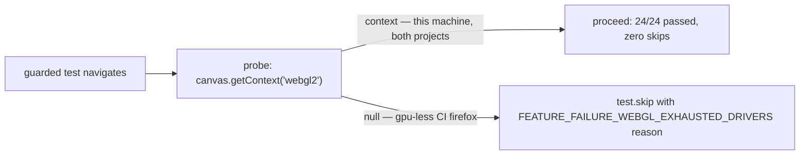

All five requirements check out against the working tree — the guards, the shared constant, the untouched fallback test, pure insertions, and an empty `playwright.config.ts` diff. Full evaluation follows.

## Goal

Add runtime WebGL capability guards to six Playwright e2e tests so a gpu-less CI runner skips only the tests that cannot run. Concretely: a shared skip reason string containing `FEATURE_FAILURE_WEBGL_EXHAUSTED_DRIVERS` and the browser name; a `requireWebgl2(page)` helper in `tests/e2e/foundation.spec.ts` that runs exactly `await page.evaluate(() => !!document.createElement('canvas').getContext('webgl2'))` and calls `test.skip(!ok, reason)` when false, invoked right after navigation in the five WebGL-dependent foundation tests (starts the drive :59, ignores repeated Start activation :86, continues when audio activation fails :103, stops after context loss :142, keeps rendering across resize :159); the same probe inlined after navigation in tooling's `provides a real WebGL 2 context` (:23). The WebGL-fallback test (:128 — it patches WebGL off itself) and every non-WebGL test stay unguarded; every existing line stays verbatim, `playwright.config.ts` is unchanged, there are no unconditional skips, nothing may skip on this WebGL-capable Windows machine, and changes land in the two spec files only. Acceptance: `findstr /c:"FEATURE_FAILURE_WEBGL_EXHAUSTED_DRIVERS" tests\e2e\foundation.spec.ts tests\e2e\tooling.spec.ts >nul && npm run verify`.

## Result

All five requirements (R1–R5) are implemented in the working tree and verified by the operator's own acceptance command, which exits 0 after `findstr` locates the marker in both spec files and `npm run verify` completes lint, typecheck, 9/9 unit tests, a clean build, 24/24 Playwright tests across the chrome and firefox projects with zero skips, and the size budget check. Coverage report: "No changed executable line was measured." (its conclusion reads "no acceptance segment could be measured: nothing above says whether the change was executed" — `findstr` and `npm run verify` are unsupported segment types for the coverage tooling).

## What worked

Task T1 — Guard the WebGL tests behind a runtime capability check (acceptance exit 0, status done):

- **Shared reason string (R2):** identical `WEBGL_SKIP_REASON` constants — same name, same value, containing the marker and `${browser}` — at `tests/e2e/foundation.spec.ts:59-60` and `tests/e2e/tooling.spec.ts:9-10`. A repo grep confirms the only two `test.skip` calls (`foundation.spec.ts:65`, `tooling.spec.ts:30`) both use it, so no other skip-reason text exists.
- **Foundation guard and call sites (R1):** `requireWebgl2` at `tests/e2e/foundation.spec.ts:62-66` with the exact probe on :64; called immediately after each test's navigation at :72 (goto :71), :99 (goto :98), :119 (goto :118, after `blockAudio` at :117), :157 (goto :156), and :175 (goto :174).
- **Tooling inline probe (R1):** `tests/e2e/tooling.spec.ts:29-30`, immediately after `page.goto('/')` (:28) and before the existing `report` evaluation (:31), exactly as specified.
- **Unguarded tests preserved (R3):** the fallback test `tests/e2e/foundation.spec.ts:141-153` has no guard and still patches WebGL off itself (:143); the non-WebGL tests (`foundation.spec.ts:189`, `:197`; `tooling.spec.ts:12`, `:21`, `:40`) are untouched.
- **Execution proof:** the acceptance run exercises the guard's proceed path through every real call site — all six guarded tests pass in both projects (chrome ok 1, 2, 3, 5, 6 and tooling ok 11; firefox ok 13, 14, 15, 17, 18 and tooling ok 23), the fallback test still runs everywhere (ok 4 chrome at 285 ms, ok 16 firefox at 2.4 s), the output reads "24 passed" with no skipped entries, vitest passes 9/9, and the bundle sits at 119,748 gzipped against a 300,000 limit. Exit 0 on both the task-level and plan-level acceptance runs.
- **Fidelity gate resolved:** the two earlier `FIDELITY: WEAKENED` verdicts (the plan describing the reason as per-file copies) were addressed — the landed plan restates R2 as one shared string, and the code realizes it as the identical constant described above.

## What did not

- Nothing in the task's own terms: the acceptance command passed, and no requirement failed or was skipped. Two honest limits remain. First, the skip branch (`test.skip` with a false probe) never executes anywhere in this run's evidence, because this machine exposes WebGL 2 and R4 makes zero local skips a pass condition — the intended six Firefox skips on gpu-less CI are implemented by construction but were not observed in any run from this batch (the cited failing CI runs 41857093016 and 41867354742 predate the change). Second, the work is uncommitted: HEAD is still `2a29bab` and the guards exist only as working-tree modifications (the run's commit/push step never executed), and the coverage tooling could not measure the acceptance command at all.

## Questions that need your input

none — the one interpretation call (the shared string realized as an identical module-scope constant in each of the two in-scope files, since R5 forbids a third file and the findstr evidence needs the literal in both) is documented in the plan and matches the landed code.

## Requirement review

| Requirement | Verdict | Evidence |
|---|---|---|
| R1 — six guards built on exactly `page.evaluate(() => !!document.createElement('canvas').getContext('webgl2'))`, calling `test.skip(!ok, reason)` when false, placed right after navigation in the five named foundation tests and tooling's WebGL test | verified | Helper `tests/e2e/foundation.spec.ts:62-66` (probe :64, skip :65); calls at :72, :99, :119, :157, :175, each immediately after goto; inline probe `tests/e2e/tooling.spec.ts:29-30` before the existing evaluation :31. Acceptance exit 0 runs all six guarded tests through the guard in both projects (firefox listings at foundation.spec.ts:69, :97, :115, :155, :173 and tooling.spec.ts:27 all "ok"; "24 passed", zero skips). The probe-false skip branch is not exercised on this WebGL-capable machine — by design per R4; see follow-ups |
| R2 — shared reason string containing FEATURE_FAILURE_WEBGL_EXHAUSTED_DRIVERS and the browser name, used by every guard; no other skip-reason text | verified | Identical `WEBGL_SKIP_REASON` at `foundation.spec.ts:59-60` and `tooling.spec.ts:9-10`; repo grep shows the only `test.skip` calls (foundation :65, tooling :30) both reference it |
| R3 — fallback test (:128) and every non-WebGL test unguarded; fallback must still run everywhere | verified | `foundation.spec.ts:141-153` has no guard and self-patches WebGL off (:143), passing on both projects (acceptance ok 4 chrome, ok 16 firefox); non-WebGL tests `foundation.spec.ts:189`, `:197` and `tooling.spec.ts:12`, `:21`, `:40` untouched and passing |
| R4 — existing lines verbatim; playwright.config.ts unchanged; no unconditional skips; nothing skips locally under npm run verify | verified | `git diff --stat`: 15 + 6 pure insertions, zero deletions, only the two spec files; `git diff playwright.config.ts` empty; skips conditional on `!ok`; acceptance output shows "24 passed" with no skipped entries, vitest 9/9, exit 0 |
| R5 — changes land in tests/e2e/foundation.spec.ts and tests/e2e/tooling.spec.ts only | verified | Working-tree source diff touches exactly those two files; the only other modified path, `.factory/plans/7a44b035.md`, is the Factory workflow's own plan-metadata update, not product source |

## Decisions and changes

- **Agreed (fidelity-gated): shared-string mechanics.** The "shared reason string" is realized as one named constant — identical name and value — declared at module scope in each in-scope spec file. A third helper module would violate R5's two-file scope, and importing one spec from the other would drop the literal marker from tooling.spec.ts, breaking the acceptance command's findstr evidence. Two earlier plan rounds were rejected by the fidelity gate for framing this as "its own copy"; the accepted framing ("one shared string") is what landed, and the code matches it.
- **Agreed: browser name via `test.info().project.name`** (`chrome` / `firefox`), read inside the guard so no test signature changed — consistent with R4's verbatim-lines rule.
- **Note, not an amendment:** `.factory/plans/7a44b035.md` also changed on disk (10 insertions, 5 deletions). That is the Factory workflow's own bookkeeping — marking checkpoint 8671a5ce done — not an implementer-added scope item.
- No other scope amendments were proposed; `playwright.config.ts`, app source, and all other tests are untouched.

## Current position

T1 (8671a5ce) is done with exit-0 acceptance evidence: the marker is present in both spec files, and `npm run verify` passes end to end — lint, typecheck, 9/9 unit tests, build, 24/24 e2e tests with zero skips, size under budget. Plan 7a44b035 is status "done". The change is not yet committed (HEAD remains `2a29bab`; the guards are working-tree modifications), which is the only outstanding mechanical step. No blockers. Next sensible step: commit and push the two spec files, then read the next gpu-less ubuntu CI run's Playwright summary to confirm the six Firefox skips with the marker reason.

## Follow-up checkpoints

- [ ] R1 (skip branch — unverified): no evidence in this run shows a probe-false skip, since this machine exposes WebGL 2 and R4 forbids local skips. Missing proof: gpu-less CI Firefox skipping exactly the six guarded tests with the `FEATURE_FAILURE_WEBGL_EXHAUSTED_DRIVERS` reason while chrome and the fallback test still run. Verification idea: compare the Playwright summary of the next ubuntu CI run against the failed runs 41857093016 and 41867354742 — six firefox skips plus otherwise-green is the before/after proof the guards work as intended.

## Proposed tasks

none
